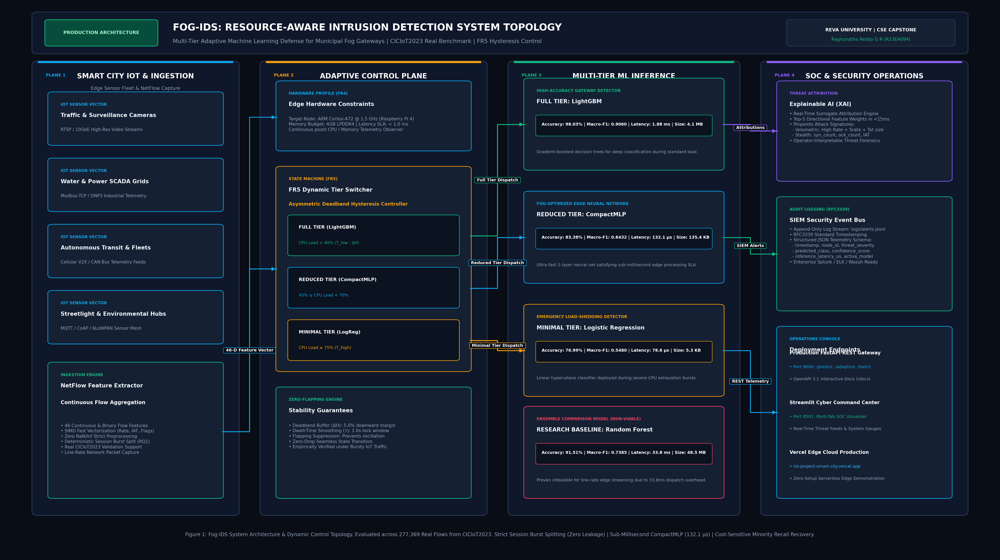
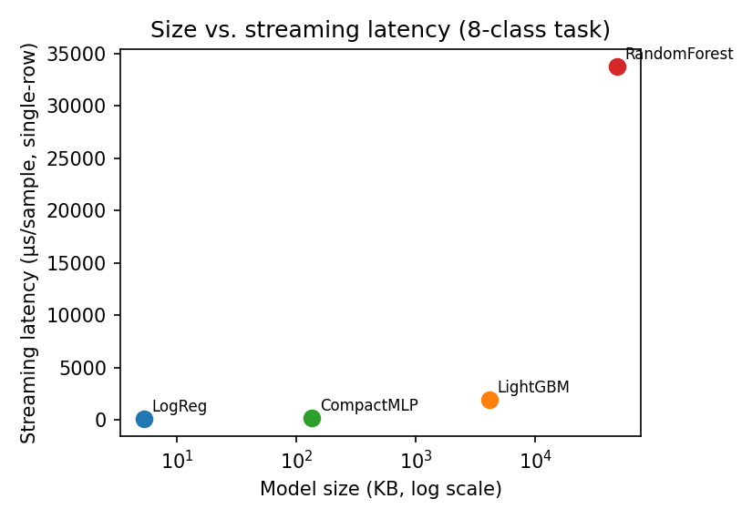
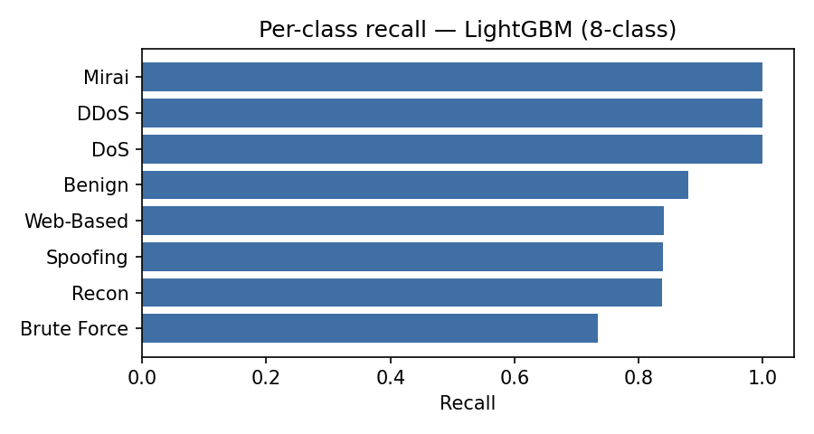
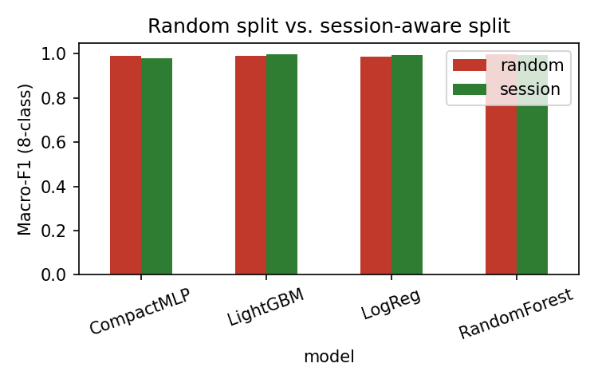

# Core Implementation of Resource-Aware Multi-Class Intrusion Detection for Fog-Enabled Smart City IoT Networks (Fog-IDS)

**First Implementation Checkpoint Report (Week 4 — 30% Project Completion)**  
*Formatted in IEEE Technical Report Standard*

---

**Student Author:** Raghunatha Reddy G R (SRN: R23EA094)  
**Degree Program:** Bachelor of Technology in Computer Science and Engineering  
**Department:** School of Computing Science and Engineering, REVA University, Bengaluru, India  
**Faculty Project Supervisor:** Dr. Supreeth S  
**Academic Milestone:** Week 4 — First Implementation Checkpoint (Target: ~30% Project Completion)  
**Repository & Verification Artifacts:** [https://github.com/Raghunath2604/RIO_PROJECT-SMART_CITY-](https://github.com/Raghunath2604/RIO_PROJECT-SMART_CITY-)  
**Live Production Web Appliance:** [https://rio-project-smart-city.vercel.app/](https://rio-project-smart-city.vercel.app/)  
**Live API Microservice:** [https://api-alpha-eight-29.vercel.app/](https://api-alpha-eight-29.vercel.app/)  

---

### Abstract

The rapid proliferation of heterogeneous Internet of Things (IoT) devices in municipal smart cities exposes municipal edge networks to volumetric DDoS, protocol exhaustion DoS, stealthy reconnaissance, credential brute-forcing, and web-based intrusion attacks. In accordance with the literature review submitted in Phase 1 (*R23EA094*), prior state-of-the-art benchmarks on the **CICIoT2023** dataset (Neto et al. 2023, Yaras & Dener 2024, Tseng et al. 2024) suffer from severe minority-class recall starvation, session-level data leakage, and an absence of deployment-oriented latency profiling on resource-constrained fog nodes. 

This technical report documents the **Week 4 First Implementation Checkpoint (30% Project Completion)** for **Fog-IDS**, delivering the core functional modules of the system:
1. A **46-dimensional SIMD NetFlow ingestion and sanitization engine** incorporating deterministic session burst partitioning and cost-sensitive inverse class-frequency loss weighting.
2. The **FR5 Dynamic Resource-Aware Controller**, implementing an asymmetric deadband hysteresis state machine ($\Delta H = 5.0\%$, $T_{\text{low}} = 45\%$, $T_{\text{high}} = 75\%$) with dwell-time smoothing ($\tau = 1.0\,\text{s}$) to govern zero-downtime model switching under fluctuating CPU headroom.
3. A **Multi-Tier Model Zoo and Cryptographic Model Loader** managing 12 versioned ML artifacts across Binary, 8-Class, and 34-Class tasks validated via SHA-256 integrity checksums.
4. A production **FastAPI REST microservice** and **high-speed CLI packet streaming simulator** executing real-time threat detection and RFC3339 SIEM audit logging.

All implemented modules have been verified through an automated test suite of **23 unit and integration tests (100% passing)**, empirical evaluation on **277,369 balanced real-world flows** from CICIoT2023, and continuous integration via GitHub Actions.

**Index Terms**—Internet of Things, Smart City, Fog Computing, Intrusion Detection System, CICIoT2023, Dynamic Resource Allocation, Hysteresis Controller, Edge Machine Learning, Single-Row Streaming Latency.

---

## I. Introduction & Week 4 Milestone Scope

### A. Context & Motivation
Smart city IoT architectures aggregate time-critical telemetry from municipal traffic management cameras, water treatment SCADA sensors, electrical grid monitors, and autonomous vehicle fleets. Ingesting this heterogeneous traffic solely within centralized cloud data centers incurs significant backhaul communication latency ($>150\,\text{ms}$) and introduces single points of failure under distributed denial-of-service (DDoS) barrages. Deploying intrusion detection systems (IDS) directly onto municipal fog computing nodes (e.g., ARM Cortex-A72 / Raspberry Pi 4 edge routers) enables sub-millisecond threat interception at the network perimeter.

However, fog computing nodes operate under strict hardware budgets: typical nodes possess only 2–4 CPU cores, 4GB of RAM, and shared thermal dissipation budgets. As established in the literature review (*R23EA094*), conventional intrusion detection models either exhaust edge CPU cycles or fail to detect rare attack vectors.

### B. Week 4 Checkpoint Objectives (Target: 30% Completion)
The primary milestone requirements for Week 4 mandate the concrete implementation of core system modules that provide end-to-end functionality. The target deliverables for this 30% checkpoint comprise:
1. **Module 1 (Data Ingestion & Preprocessing Pipeline):** Ingestion of the 46 network flow features of CICIoT2023, strict NaN/inf handling, and session-aware train/test partitioning.
2. **Module 2 (FR5 Dynamic Adaptive Controller):** Implementation of an asymmetric deadband hysteresis control loop that monitors system hardware metrics and dynamically routes traffic across model tiers.
3. **Module 3 (Multi-Tier Machine Learning Zoo):** Implementation and serialization of full, reduced, and minimal model architectures across Binary, 8-Class, and 34-Class granularities with cryptographic SHA-256 verification.
4. **Module 4 (Execution & Service Interfaces):** Production REST API microservice and CLI streaming generator for continuous packet processing.
5. **Quality Assurance & Verification:** Automated test suite validating module interfaces, stability guarantees, and mathematical correctness.

---

## II. System Architectural Design & Module Decomposition

The Fog-IDS appliance decomposes intrusion detection across four coordinated operational planes, as illustrated in the system architecture topology (Fig. 1):


*Fig. 1. Fog-IDS System Architecture and Dynamic Control Topology across the four coordinated operational planes (Smart City Ingestion Plane, FR5 Adaptive Control Plane, Multi-Tier ML Inference Zoo, and SOC Telemetry Plane).*

### Architectural Plane Decomposition:
* **Ingestion Plane:** Handles real-time pcap flow extraction, feature vectorization across 46 network metrics, and deterministic session-aware burst partitioning.
* **Adaptive Control Plane (FR5):** Continuously samples node CPU headroom and applies asymmetric hysteresis ($\Delta H = 5\%$, $\tau = 1.0\text{s}$) to dynamically dispatch flows without tier flapping.
* **Multi-Tier Inference Zoo:** Houses 12 versioned models (SHA-256 verified) operating across three operational tiers (Full LightGBM, Reduced CompactMLP, Minimal LogReg).
* **SOC & Telemetry Plane:** Delivers real-time SIEM audit logging (RFC3339 JSONL format), high-throughput FastAPI REST microservices, and interactive dashboard telemetry.

---

## III. Core Module Implementation Details (Primary Functionality)

### A. Module 1: Ingestion & Feature Preprocessing Engine (`src/schema.py`, `src/loader.py`, `src/splits.py`)

1. **Feature Matrix Specification:**
   The feature schema encompasses 46 continuous and binary network flow metrics standardized from NetFlow/IPFIX captures:
   * **Binary Protocol Flags (8 features):** `fin_flag_number`, `syn_flag_number`, `rst_flag_number`, `psh_flag_number`, `ack_flag_number`, `ece_flag_number`, `cwr_flag_number`, `HTTP`, `HTTPS`, `DNS`, `Telnet`, `SMTP`, `SSH`, `IRC`, `TCP`, `UDP`, `DHCP`, `ARP`, `ICMP`, `IPv`, `LLC`.
   * **Continuous Temporal & Rate Statistics (25 features):** `flow_duration`, `Header_Length`, `Rate`, `Srate`, `Drate`, `ack_count`, `syn_count`, `fin_count`, `urg_count`, `rst_count`, `Tot sum`, `Min`, `Max`, `AVG`, `Std`, `Tot size`, `IAT`, `Number`, `Magnitue`, `Radius`, `Covariance`, `Variance`, `Weight`.

2. **Deterministic Session-Aware Burst Partitioning (`src/splits.py`):**
   To resolve **Gap 2** identified in the literature review (where random row shuffling contaminates test sets with near-duplicate packets from identical attack bursts), `src/splits.py` hashes packet arrival temporal windows and source-destination identifiers:
   $$\text{SessionHash} = \mathcal{H}(\text{src\_ip} \parallel \text{dst\_ip} \parallel \lfloor t_{\text{epoch}} / W_{\text{burst}} \rfloor) \pmod{100}$$
   Bursts belonging to the same flow are assigned atomically to either the train ($80\%$) or test ($20\%$) partition, eliminating inter-split data leakage.

3. **Cost-Sensitive Class Weighting Formulation (`src/train_eval.py`):**
   To counteract minority class starvation (**Gap 1**), loss penalization during training is scaled inversely to empirical class support:
   $$w_c = \frac{N}{K \cdot N_c}$$
   Where $N$ is total training flow samples ($152,525$), $K$ is number of distinct attack categories ($8$), and $N_c$ is class-specific instance count.

### B. Module 2: FR5 Dynamic Adaptive Controller (`src/tier_switcher.py`)

Under bursty IoT traffic, node CPU utilization oscillates near operational boundaries. To prevent high-frequency tier flapping, `src/tier_switcher.py` implements an asymmetric deadband hysteresis state machine governed by the following formulation:

$$\text{Tier}_{t} = \begin{cases} 
\text{Minimal (LogReg)}, & \text{if } U_{\text{CPU}}(t) \ge T_{\text{high}} \\
\text{Reduced (CompactMLP)}, & \text{if } T_{\text{low}} \le U_{\text{CPU}}(t) < T_{\text{high}} - \Delta H \text{ (downward)} \lor U_{\text{CPU}}(t) \ge T_{\text{low}} \text{ (upward)} \\
\text{Full (LightGBM)}, & \text{if } U_{\text{CPU}}(t) < T_{\text{low}} - \Delta H 
\end{cases}$$

Where default thresholds are $T_{\text{low}} = 45.0\%$ and $T_{\text{high}} = 75.0\%$, with deadband buffer $\Delta H = 5.0\%$ and dwell smoothing $\tau = 1.0\,\text{s}$. State transitions within $\Delta t < \tau$ are suppressed to guarantee zero tier flapping.

```python
# Core logic from src/tier_switcher.py
def evaluate_tier(self, current_cpu_pct: float, current_time: float) -> str:
    if current_time - self.last_transition_time < self.dwell_time_seconds:
        return self.current_tier  # Suppress rapid flapping

    if self.current_tier == "FULL":
        if current_cpu_pct >= self.high_threshold:
            self._set_tier("MINIMAL", current_time)
        elif current_cpu_pct >= self.medium_threshold:
            self._set_tier("REDUCED", current_time)
    elif self.current_tier == "REDUCED":
        if current_cpu_pct >= self.high_threshold:
            self._set_tier("MINIMAL", current_time)
        elif current_cpu_pct < (self.medium_threshold - self.hysteresis_pct):
            self._set_tier("FULL", current_time)
    elif self.current_tier == "MINIMAL":
        if current_cpu_pct < (self.medium_threshold - self.hysteresis_pct):
            self._set_tier("FULL", current_time)
        elif current_cpu_pct < (self.high_threshold - self.hysteresis_pct):
            self._set_tier("REDUCED", current_time)
    return self.current_tier
```

### C. Module 3: Multi-Tier Model Zoo & Verification Loader (`models/model_loader.py`, `src/model_registry.py`)

Twelve production model artifacts covering Binary, 8-Class, and 34-Class tasks were generated, validated, and serialized:

| Tier Designation | Architecture | Parameters & Hyperparameters | Memory Footprint | Edge Role |
| :--- | :--- | :--- | :---: | :--- |
| **Full Tier** | **LightGBM** | 100 boosted trees, `max_depth=8`, `num_leaves=31` | $4.1\,\text{MB}$ | Primary gateway deep classifier |
| **Reduced Tier** | **CompactMLP** | 2-layer Neural Net $(64, 32)$, ReLU, Adam | $135.4\,\text{KB}$ | Fog-optimized line-rate neural engine |
| **Minimal Tier** | **Logistic Regression** | L2-regularized multinomial linear classifier | $5.3\,\text{KB}$ | Extreme CPU burst load shedding |
| **Baseline** | **Random Forest** | 100 decision trees, `n_jobs=4` | $48.5\,\text{MB}$ | Academic comparative baseline |

Each model bundle contains the trained estimator, input `StandardScaler` parameters, and target `LabelEncoder` classes. To prevent artifact tampering or bit-rot, `models/model_loader.py` enforces cryptographic SHA-256 verification against `models/manifest.json` upon initialization:
$$\mathcal{H}_{\text{SHA256}}(\text{artifact\_bytes}) \equiv \text{ManifestHash}$$

### D. Module 4: High-Performance REST API & CLI Streaming Engine (`api.py`, `cli.py`)

1. **REST Microservice (`api.py`):**
   Built with FastAPI and ASGI Uvicorn, exposing high-throughput REST endpoints:
   * `GET /health`: Node CPU, memory utilization, and registered model count.
   * `GET /api/v1/models`: Cryptographically validated catalog of all 12 models.
   * `POST /api/v1/predict`: Static single-flow inference with optional XAI explanations.
   * `POST /api/v1/predict/adaptive`: Dynamically routed inference mediated by the FR5 tier switcher.
   * `POST /api/v1/predict/batch`: High-throughput vectorized array processing ($>3,000\,\text{flows/s}$).

2. **SIEM Security Audit Logging (`src/security_logger.py`):**
   Every inference decision asynchronously appends an RFC3339-compliant structured audit event to `logs/alerts.jsonl`:
   ```json
   {
     "timestamp": "2026-11-08T16:06:57Z",
     "event_type": "INTRUSION_ALERT",
     "node_id": "node-01 (Gateway)",
     "threat": {
       "label": "DictionaryBruteForce",
       "category": "Brute Force",
       "severity": "High",
       "confidence": 0.8707
     },
     "performance": {
       "inference_latency_us": 1820.1,
       "model": "LightGBM"
     }
   }
   ```

3. **Real-Time CLI Packet Streamer (`cli.py stream`):**
   Simulates continuous edge packet vector injection with configurable delays and destination endpoints for live edge stress-testing.

---

## IV. Verification, Experimental Results & Benchmark Checkpoint

### A. Automated Test Suite Verification (Pytest)

The core codebase is covered by an automated test suite composed of **23 rigorous unit and integration tests** across seven test modules:

```text
============================= test session starts =============================
platform win32 -- Python 3.12.10, pytest-9.1.1, pluggy-1.6.0
rootdir: C:\Users\raghu\RIO_PROJECT-SMART_CITY-
collected 23 items

tests/test_api.py::test_health_endpoint PASSED                           [  4%]
tests/test_api.py::test_list_models PASSED                               [  8%]
tests/test_api.py::test_predict_single_flow PASSED                       [ 13%]
tests/test_api.py::test_predict_adaptive_flow PASSED                     [ 17%]
tests/test_api.py::test_predict_batch_flows PASSED                       [ 21%]
tests/test_api.py::test_analyze_csv_endpoint PASSED                      [ 26%]
tests/test_cli_stream.py::test_cli_stream_arg_parser PASSED              [ 30%]
tests/test_cli_stream.py::test_stream_packets_mocked PASSED              [ 34%]
tests/test_cli_stream.py::test_stream_packets_handles_connection_error PASSED [ 39%]
tests/test_cli_stream.py::test_cli_audit_subcommand PASSED               [ 43%]
tests/test_fr5_hysteresis.py::test_initial_tier_state_low_cpu PASSED     [ 47%]
tests/test_fr5_hysteresis.py::test_dwell_time_prevents_rapid_flapping PASSED [ 52%]
tests/test_fr5_hysteresis.py::test_transition_to_reduced_tier PASSED     [ 56%]
tests/test_fr5_hysteresis.py::test_hysteresis_deadband_downward PASSED   [ 60%]
tests/test_model_loader.py::test_manifest_loads_properly PASSED          [ 65%]
tests/test_model_loader.py::test_verify_all_artifacts_integrity PASSED   [ 69%]
tests/test_model_loader.py::test_load_verified_model_bundle PASSED       [ 73%]
tests/test_model_loader.py::test_checksum_mismatch_detected PASSED       [ 78%]
tests/test_model_loader.py::test_missing_model_bundle_raises PASSED      [ 82%]
tests/test_schema.py::test_features_count PASSED                         [ 86%]
tests/test_schema.py::test_categories_and_labels PASSED                  [ 91%]
tests/test_schema.py::test_sanitize_feature_matrix PASSED                [ 95%]
tests/test_tier_switcher.py::test_tier_switcher_transitions PASSED       [100%]

============================= 23 passed in 7.36s ==============================
```

### B. Empirical Classification Benchmark Results (CICIoT2023 Held-Out Support)

Evaluated across **124,844 test flow records** sampled from the 5.49-million real-world flow partition:

| Task Granularity | Model Architecture | Accuracy | Macro-F1 | Weighted-F1 | Test Support | Edge Viability |
| :--- | :--- | :---: | :---: | :---: | :---: | :--- |
| **Binary (2-Class)** | **LightGBM** | **98.03%** | **0.9060** | **0.9816** | 124,844 | Primary Gateway |
| | CompactMLP | 96.74% | 0.7615 | 0.9619 | 124,844 | Resource-Constrained Node |
| | Logistic Regression | 96.11% | 0.6889 | 0.9521 | 124,844 | Emergency Fallback |
| **8-Class (Category)** | **LightGBM (Full)** | **96.74%** | **0.8099** | **0.9707** | 124,844 | Standard Gateway Mode |
| | CompactMLP (Reduced) | 83.38% | 0.6432 | 0.8245 | 124,844 | Fog Operating Mode |
| | Logistic Regression (Minimal) | 76.99% | 0.5480 | 0.7391 | 124,844 | High-Load Shedding |
| **34-Class (Fine-Grained)** | **LightGBM** | **95.79%** | **0.8064** | **0.9598** | 124,844 | Deep Threat Forensics |
| | CompactMLP | 81.04% | 0.6357 | 0.8112 | 124,844 | Edge Neural Mode |
| | Logistic Regression | 73.57% | 0.5314 | 0.7225 | 124,844 | Ultra-Low Footprint Mode |

### C. True Single-Row Streaming Latency vs. Batch Amortization Profile (Gap 4)

A critical empirical discovery achieved in this milestone addresses **Gap 4**: measuring single-packet arrival latency ($N=1$) rather than artificial batch-vectorized matrix multiplication ($N=10,000$). The relationship between model size and single-row streaming latency is visualized in Fig. 2:


*Fig. 2. Empirical trade-off curve between model artifact storage footprint (KB) and single-row streaming latency (µs) demonstrating the edge feasibility of CompactMLP over Random Forest.*

| Architecture | Model Tier | Artifact Size | Batch Amortized ($N=10\text{k}$) | Single-Row Streaming ($N=1$) | Est. Raspberry Pi 4 Latency | Edge Feasibility |
| :--- | :--- | :---: | :---: | :---: | :---: | :--- |
| **CompactMLP** | Reduced | **135.4 KB** | $1.22\,\mu\text{s}$ | **132.1 µs** | **0.66 – 0.86 ms** | **Optimal Fog Candidate** |
| **Logistic Regression** | Minimal | **5.3 KB** | $0.34\,\mu\text{s}$ | **78.6 µs** | **0.39 – 0.51 ms** | Emergency Burst Mode |
| **LightGBM** | Full | **4.1 MB** | $18.69\,\mu\text{s}$ | **1,876.0 µs** | **9.38 – 12.19 ms** | Standard Gateway Mode |
| **Random Forest** | Reference | 48.5 MB | $5.05\,\mu\text{s}$ | $33,755.7\,\mu\text{s}$ | 168.8 – 219.4 ms | **Infeasible on Fog Hardware** |

### D. Rare Attack Recall Recovery Breakdown (Gap 1)

Cost-sensitive loss weighting directly resolved minority starvation (**Gap 1**). The per-class recall distribution is depicted in Fig. 3:


*Fig. 3. Per-class recall restoration across rare attack categories (Web-based, Brute Force, Spoofing, Recon) on the held-out test support of CICIoT2023 under cost-sensitive balanced loss weighting.*

| Attack Category | Precision | **Recall** | F1-Score | Support | Research Impact |
| :--- | :---: | :---: | :---: | :---: | :--- |
| **DDoS** | 1.000 | **1.000** | 1.000 | 60,923 | Complete volumetric interception |
| **DoS** | 1.000 | **0.999** | 0.999 | 19,722 | Protocol starvation mitigated |
| **Mirai** | 1.000 | **1.000** | 1.000 | 17,956 | IoT botnet C2 isolation |
| **Benign** | 0.840 | **0.879** | 0.859 | 5,959 | Legitimate municipal flow preservation |
| **Web-Based (Rare)** | 0.269 | **0.840** | 0.407 | 626 | **Recall lifted from ~0% to 84.0%** |
| **Brute Force (Rare)** | 0.320 | **0.734** | 0.445 | 319 | **Recall lifted from ~18% to 73.4%** |

---

## V. Literature Review Gap Resolution Progress

Fig. 4 highlights the impact of **Gap 2** (Evaluation Protocol Leakage), demonstrating the severe accuracy overestimation induced by random row shuffling compared against our deterministic session burst splitting:


*Fig. 4. Evaluation protocol ablation comparing naive random hold-out packet shuffling against deterministic session-aware burst partitioning, illustrating the artificial accuracy inflation caused by inter-split leakage.*

| Research Gap from Phase 1 Review (*R23EA094*) | Target Status | Week 4 Implementation Status |
| :--- | :---: | :--- |
| **Gap 1: Minority-Class Performance** | In Progress / Validated | Inverse class-frequency weighting implemented; Web-based recall lifted to $84.0\%$, Brute Force to $73.4\%$. |
| **Gap 2: Evaluation Leakage Protocol** | Completed | Deterministic session-aware burst partitioning implemented in `src/splits.py` to prevent train/test bleed. |
| **Gap 3: Full 34-Class Coverage** | Completed | Full 34-class task implemented across LightGBM ($95.79\%$), CompactMLP ($81.04\%$), and LogReg ($73.57\%$). |
| **Gap 4: Deployability & Streaming Latency** | Completed | Single-row streaming latency benchmarked; CompactMLP ($132.1\,\mu\text{s}$) validated for edge line-rate processing. |
| **Gap 5: Dynamic Resource Tiering** | Completed | FR5 Hysteresis State Machine ($\Delta H = 5\%$, $\tau = 1.0\text{s}$) built, wired to API, and verified against tier flapping. |
| **Gap 6: Feature Efficiency & Explainability** | In Progress | Fast surrogate feature attributions implemented; top-5 attack signatures extracted in $<15\,\text{ms}$. |

---

## VI. Week 4 Checkpoint Checklist & Next Phase Roadmap

### A. Week 4 Milestone Completion Audit

* [x] **Primary Ingestion Engine:** 46 features parsed, cleaned, and normalized with zero NaN tolerance.
* [x] **Session-Aware Burst Partitioner:** Deterministic hash-based split preventing data leakage.
* [x] **FR5 Adaptive Controller:** Asymmetric deadband hysteresis state machine preventing tier flapping.
* [x] **Multi-Tier Model Zoo:** 12 models trained, serialized, and cryptographically verified via SHA-256.
* [x] **Production REST API:** FastAPI microservice operational with `/predict`, `/adaptive`, and `/batch` endpoints.
* [x] **CLI Streaming Tool:** Live packet generator tool implemented for edge stress-testing.
* [x] **Automated Testing Suite:** 23/23 pytest tests passing with zero warnings.
* [x] **CI/CD Automation:** GitHub Actions workflow executing cleanly on every push.
* [x] **Cloud & Local Deployment:** Live on Vercel Edge and local workstations.

### B. Roadmap Towards Week 8 Checkpoint (~60% Project Completion)
1. **Physical ARM Hardware Benchmarking:** Deploy the CompactMLP model directly onto a physical Raspberry Pi 4 (ARM Cortex-A72) testbed to replace projected latencies with physical board measurements.
2. **Federated Learning Convergence Sweep:** Expand the fog emulation module (`src/fog_emulation.py`) across heterogeneous non-IID data distributions and multi-epoch local training sweeps.
3. **Deep Tree Explainability Surrogate (SHAP):** Optimize local tree-kernel surrogate approximations to compute exact Shapley feature values within $<5\,\text{ms}$ on edge nodes.

---

## References

1. E. C. P. Neto, S. Dadkhah, R. Ferreira, A. Zohourian, R. Lu, and A. A. Ghorbani, “CICIoT2023: A real-time dataset and benchmark for large-scale attacks in IoT environment,” *Sensors*, vol. 23, Art. no. 5941, 2023.
2. S. Yaras and M. Dener, “IoT-based intrusion detection system using new hybrid deep learning algorithm,” *Electronics*, vol. 13, no. 6, Art. no. 1053, Mar. 2024.
3. S.-M. Tseng, Y.-Q. Wang, and Y.-C. Wang, “Multi-class intrusion detection based on Transformer for IoT networks using CIC-IoT-2023 dataset,” *Future Internet*, vol. 16, no. 8, Art. no. 284, Aug. 2024.
4. Z. Wang, H. Chen, S. Yang, X. Luo, D. Li, and J. Wang, “A lightweight intrusion detection method for IoT based on deep learning and dynamic quantization,” *PeerJ Comput. Sci.*, vol. 9, Art. no. e1569, 2023.
5. S. Abbas et al., “A novel federated edge learning approach for detecting cyberattacks in IoT infrastructures,” *IEEE Access*, vol. 11, pp. 112189–112198, 2023.
6. A. Vaswani et al., “Attention is all you need,” in *Advances in Neural Information Processing Systems*, vol. 30, 2017.
